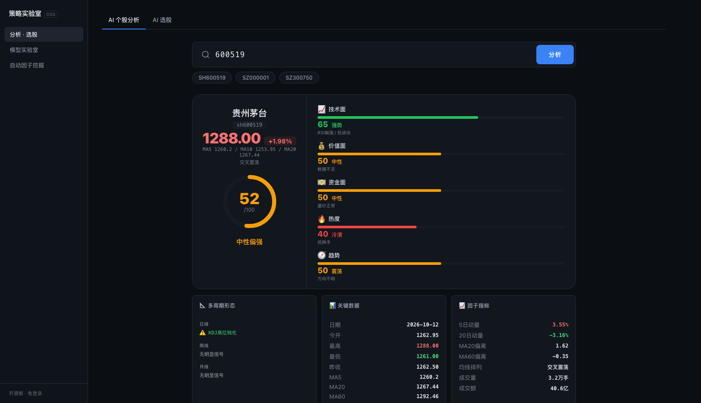
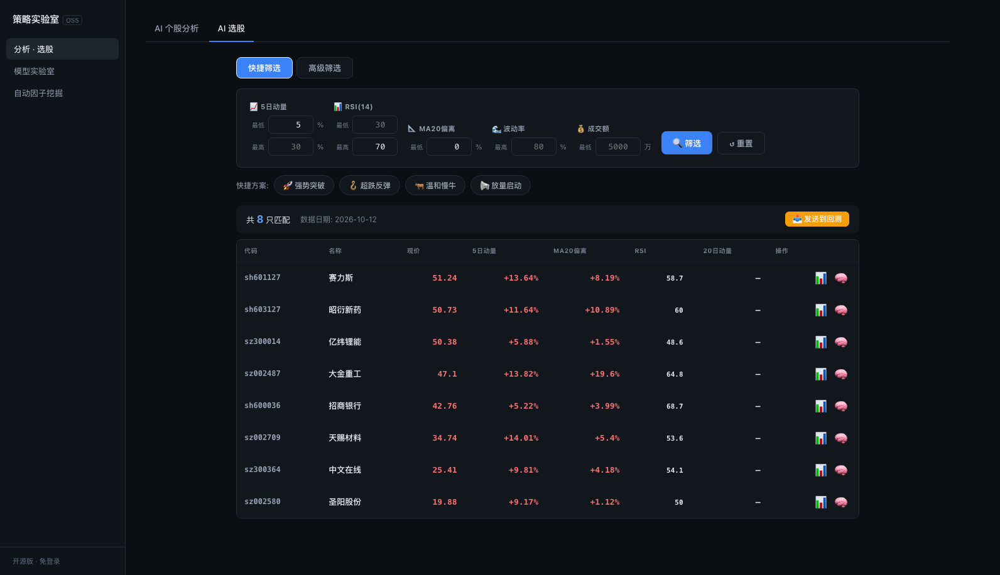
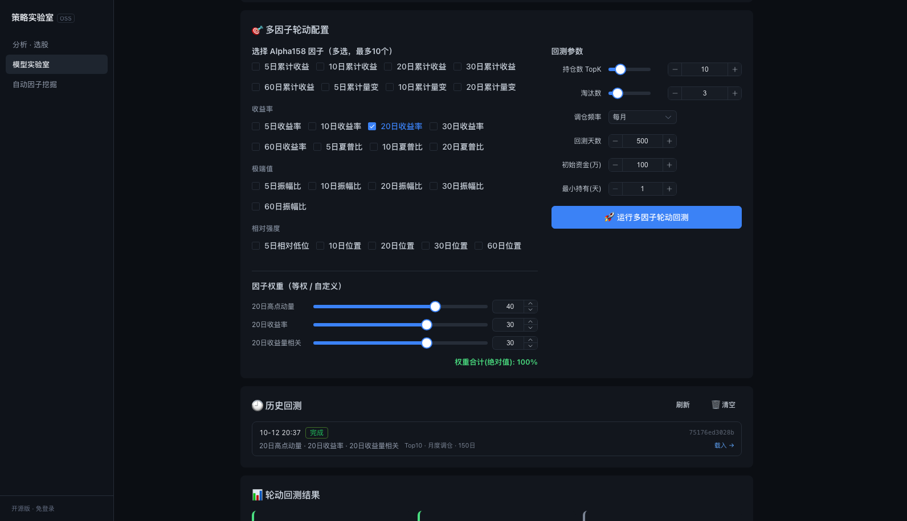
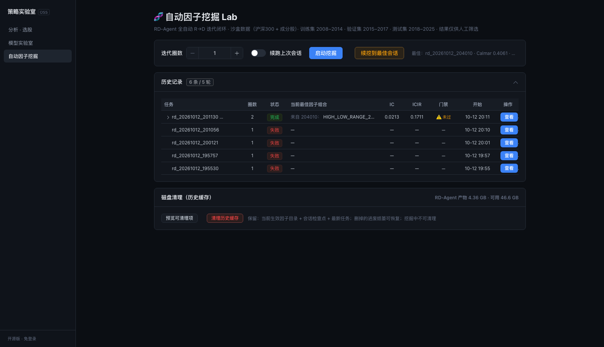

# QuantLab OSS · 策略实验室（开源版）

> 🧪 一个 AI 驱动的量化分析平台 —— 因子分析、选股、回测、模型实验与自动因子挖掘。

[](./LICENSE)
[](https://www.python.org/)
[](https://vuejs.org/)
[](./CONTRIBUTING.md)

> ⭐ 如果这个项目对你有帮助，欢迎点个 **Star** 支持一下！

> ⚠️ 本项目仅供**学习与研究**，所有输出不构成任何投资建议。

---

## ✨ 功能

- **因子分析 / 选股**：基于 Qlib + Alpha158 的因子计算与股票筛选
- **多因子轮动回测**：Alpha158 多因子排名选股 → TopK 持仓定期轮动（含涨跌停 / T+1 / 真实成本模型约束）；任务实时落盘、重启不丢，不同访客只看得到自己的任务
- **模型实验室**：LightGBM 等模型训练与评估
- **自动因子挖掘**：集成 RD-Agent（可选），一键发起因子挖掘任务
- **免登录**：开源版无账号体系，开箱即用
- **深色极简界面**：Vue3 + Element Plus 深色主题，单色系 + 细边框，无冗余装饰

## 🖼️ 截图 / 在线 Demo

| 个股分析 | 选股（多因子筛选） |
|:---:|:---:|
|  |  |

| 模型实验室（策略回测 / 模型训练） | 自动因子挖掘 |
|:---:|:---:|
|  |  |

> 以上截图基于**真实行情**生成（`make fetch-data` 拉取的近 1 年数据 · 300 只标的）。
>
> 🔗 **在线 Demo**：https://dennynanmac-mini.tail1971a3.ts.net:8444
> （免登录 · 开箱即用 · 演示站 RD-Agent 为**只读**：历史记录可查看，但不支持发起挖掘，以免消耗付费 LLM 额度）

## 🚀 快速开始

> 环境要求：Python **3.12+**、Node **20+**。可选配置（LLM Key、行情库路径等）全部可留空，见 `.env.example`。
> 🧪 仓库**不附带真实行情数据**，开箱即用的是一套可复现的**合成样例数据**（40 只 × 300 日）。

### 方式一：本地开发（推荐）

```bash
git clone https://github.com/dennynan/quantlab-oss.git quantlab-oss && cd quantlab-oss
make sample-data     # 生成样例行情库 data/market.db（首次必跑）
make qlib-sample     # 由 data/market.db 构建 Qlib 数据集 qlib_data/（因子分析 / 回测需要）

# 后端
cd backend && pip install -r requirements.txt
uvicorn main:app --reload --port 5001

# 前端（另开终端）
cd frontend && npm install && npm run dev
# 前端 http://localhost:5173   后端 http://localhost:5001/docs
```

> 想用真实近 1 年行情？见下方「📈 换成真实行情」。

### 方式二：Docker（可选，未在 CI / 实机实测）

```bash
make sample-data
make qlib-sample
make up              # 构建并启动
# 前端 http://localhost:8080   后端 http://localhost:5001/docs
```

## 📈 换成真实行情（可选）

自带的是可复现的**合成样例数据**。想跑真实行情，一条命令：

```bash
make fetch-data      # 近 1 年 × 300 只（内置高流动性标的池）
make qlib-sample     # 重建 Qlib 数据集
```

`scripts/fetch_real_data.py` 为**纯标准库**实现（无需 pip 安装、无需 token），从公开接口拉取日 K（前复权，主源东方财富、被限流自动回退腾讯源），周/月 K 与 MA/RSI/KDJ/BOLL 均本地计算，产出与样例库**逐列同构**的 `market.db`（旧库自动备份为 `market.db.bak`）。

```bash
make fetch-data ARGS="--top 50"                        # 快速验证
make fetch-data ARGS="--symbols 600519,000001,300750"
make fetch-data ARGS="--start 2025-01-01 --end 2025-12-31"
python scripts/fetch_real_data.py --list               # 查看内置标的池
```

> ⚠️ 数据版权归原数据源所有，仅供本地研究学习，请勿再分发；也请勿高频请求。

## 📦 目录结构

```
quantlab-oss/
├── backend/        FastAPI 后端（routers/ services/）
├── frontend/       Vue3 + Vite 前端
├── examples/       样例数据生成脚本
├── scripts/        真实行情拉取 / Qlib 数据构建 / 标的池
├── docker/         Dockerfile 与 nginx 配置
├── docs/           架构说明与截图
└── docker-compose.yml
```

## 🤖 RD-Agent（可选）

「自动因子挖掘」由微软的第三方框架 [RD-Agent](https://github.com/microsoft/RD-Agent) 驱动——
它**不是本项目代码**，需在你本机单独安装并配好（任何部署方式都如此，与本项目是否开源无关）；
未配置时该模块只给出清晰提示（含缺哪一项），不影响其余功能。

### 工作目录隔离（重要）

RD-Agent 的 workspace / 日志 / pickle 缓存体积很大（单次挖掘可达 GB 级），
本项目默认把它放在**仓库内** `<repo>/data/rdagent_demo`，与机器上其他 RD-Agent
部署（例如 `~/rdagent_demo`）互不干扰：

| 环境变量 | 默认值 | 说明 |
|---|---|---|
| `RDAGENT_HOME` | `<repo>/data/rdagent_demo` | RD-Agent 工作目录（含 `.env` / workspace / 日志） |
| `CONDA_ROOT` | `~/miniforge3` | conda 根目录 |
| `RDAGENT_CONDA_ENV` | 取 `<RDAGENT_HOME>/.env` 的 `CONDA_ENV_NAME`，否则 `rdagent` | 装了 rdagent 的 conda 环境名 |

### 配置步骤

1. 在一个独立 conda 环境里装好 rdagent（例如 `conda create -n rdagent_oss ...; pip install -e /path/to/RD-Agent`），
   建议**不要**与其他项目的环境共用，避免版本互相干扰。
2. 在 `<RDAGENT_HOME>/.env` 写入 LLM 凭证等（参考 `.env.example` 的 RD-Agent 段）；
   若环境名不是 `rdagent`，在该文件里设 `CONDA_ENV_NAME=<你的环境名>`。
3. 确认 `<RDAGENT_HOME>` 下已有 `git_ignore_folder/factor_implementation_source_data`（K 线源数据）
   与空的 `log/jobs`、`pickle_cache` 目录。

启动挖掘时后端会先做环境预检，缺项会直接报错列出（不再出现「一直挖掘中」的假象）。

## 🙏 致谢

- [Qlib](https://github.com/microsoft/qlib)（MIT）
- [RD-Agent](https://github.com/microsoft/RD-Agent)（MIT）
- FastAPI / Vue3 / Element Plus / ECharts

第三方依赖的许可证清单见 `THIRD_PARTY_LICENSES.md`。

## 📄 许可证

[MIT](./LICENSE) © 2026 南叔 | AI实战派
